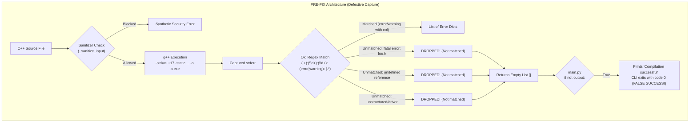
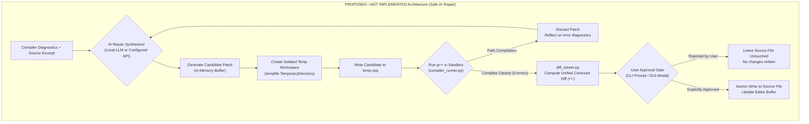

# Green Self-Healing Compiler: System Architecture & Technical Guide

---

## 1. Executive Summary & Purpose

The **Green Self-Healing Compiler** is an educational and developer-assistance meta-tool layered on top of standard C++ toolchains (`g++`). Developed as a Compiler Design Project-Based Learning (PBL) system, its primary purpose is to transform terse, opaque compiler diagnostics into structured, human-readable explanations, perform static security risk audits, and provide automated program repair assistance.

### Key Architectural Principle
> **`g++` executes all actual compilation.**  
> The project does **not** replace the compiler backend. It operates as an **intelligent wrapper and post-compilation diagnostic processing pipeline** that invokes `g++`, captures `stderr` diagnostics, models them into an internal diagnostic record representation, enriches them with explanations and security classifications, and guides repair attempts.

---

## 2. Technical Glossary

| Term | Project Definition & Context |
| :--- | :--- |
| **Compiler Diagnostic** | Any message (error, fatal error, warning, note) emitted by `g++` to `stderr` describing a syntactic, semantic, or linking issue. |
| **Diagnostic Capture** | Intercepting, filtering, and parsing raw compiler `stderr` text streams into structured, machine-usable data structures. |
| **Lexical Analysis (Scanning)** | Breaking character streams into atomic tokens. Implemented both via `src/core/lexer.py` (formal tokenizing scanner for MiniC) and via regex tokenizers in the C++ diagnostic pipeline. |
| **AST (Abstract Syntax Tree)** | A typed tree representation of program structure. Implemented in `src/core/parser.py` (recursive descent AST construction for MiniC) and supported via `ast_extractor.py` (clang++ AST dumps for C++). |
| **Semantic Analysis** | Checking type compatibility, declaration validity, and scope rules. |
| **Symbol Table** | An associative data structure tracking identifier names, types, and lexical scope depths. Implemented in `src/core/semantic.py` featuring dedicated `Scope`, `Symbol`, and `SymbolTable` classes with hierarchical parent resolution. |
| **Intermediate Representation (IR)** | A language-independent representation of code between frontend and backend. Implemented as Three-Address Code (TAC) quadruples with control-flow lowering in `src/core/ir.py`, executed via a virtual TAC interpreter in `src/core/interpreter.py`. Diagnostic records for C++ compiler errors are represented via `CompilerError` in `src/models.py`. |
| **Peephole Transformation** | A local code transformation technique operating on a narrow sliding window of lines to correct localized syntax errors (e.g., missing semicolons, flipped stream operators). |
| **Automated Program Repair (APR)** | Automated generation and validation of source code patches to eliminate errors. |
| **Static Security Analysis** | Lexical and scope-depth pattern analysis scanning for memory safety flaws (buffer overflows, format strings, `system()` calls) without executing the binary. |
| **Adversarial Ingress/Egress Guardrail** | Regex-based pattern defense blocking adversarial prompt injection in comments (ingress) and covert trojans/backdoors in generated patches (egress). |
| **Carbon & Energy Telemetry** | Computational resource accounting via `codecarbon`, tracking wall-clock execution time and estimated CPU/RAM power draw. |

---

## 3. Module-by-Module Architecture

The repository code is organized under [`src/`](file:///w:/Projects/toacd-pbl/src):

```
w:\Projects\toacd-pbl\
├── src/
│   ├── compiler_runner.py    # Toolchain discovery, input sanitization, stderr diagnostic capture
│   ├── error_parser.py       # Converts diagnostic records into CompilerError models & loads context
│   ├── models.py             # CompilerError and diagnostic data classes
│   ├── ast_extractor.py      # Clang AST extraction (optional clang++ dependency)
│   ├── error_classifier.py   # TF-IDF + Logistic Regression diagnostic category classifier
│   ├── error_explainer.py    # Multi-tier explanation engine (glossary -> ML -> regex fallbacks)
│   ├── error_normalizer.py   # Normalizes messages for dataset storage and UI display
│   ├── common_errors.py      # Curated glossary of known C++ compiler errors
│   ├── security_analyzer.py  # Static AST-less security scanner (regex + scope-depth tracking)
│   ├── auto_healer.py        # 1,214 lines of deterministic heuristic patch generators
│   ├── heal_loop.py          # 10-attempt bounded iterative auto-heal loop with CodeCarbon tracking
│   ├── diff_viewer.py        # Unified diff generator and HTML formatter
│   ├── agentic_compiler.py   # Experimental ReAct LLM compiler agent (Google AI Studio REST)
│   ├── agentic_worker.py     # QThread asynchronous worker for the LLM agent
│   ├── aai_guardrail.py      # Ingress & egress adversarial prompt injection scanner
│   ├── gui.py                # PyQt6 desktop application
│   └── main.py               # CLI analysis entry point
├── tests/
│   ├── __init__.py           # Test package initialization
│   └── test_compiler_runner.py # Standard library unittest test suite (10/10 passing)
└── test_cases/               # C++ test cases for syntax, semantic, and security scenarios
```

### Module Breakdown

#### 1. [`src/compiler_runner.py`](file:///w:/Projects/toacd-pbl/src/compiler_runner.py)
- **Role**: Toolchain discovery and diagnostic parser.
- **Toolchain Discovery**: Dynamically discovers a suitable C++ compiler (`g++`) by checking the system `PATH` and probing common MinGW/MSYS2 directories (such as `C:\msys64\ucrt64\bin\g++.exe`), configuring environment `PATH` to allow DLL resolution without shadowing system utilities. Executes:
  ```bash
  g++ -std=c++17 -static -static-libgcc -static-libstdc++ <source_file> -o a.exe
  ```
- **Sanitizer (`_sanitize_code` / `_sanitize_input`)**: Rejects source code containing forbidden system calls (`system(`, `exec(`, `popen(`, `fork(`), raw assembly (`__asm__`, `shellcode`), or restricted OS headers (`#include <sys/...>`) before invoking the compiler.
- **Diagnostic Capture Engine**: Parses `g++` `stderr` into parser-ready dictionary objects with keys `{"file", "line", "column", "type", "message", "raw"}`.

#### 2. [`src/error_parser.py`](file:///w:/Projects/toacd-pbl/src/error_parser.py)
- **Role**: Transforms captured diagnostic dictionaries or raw text blocks into instances of the [`CompilerError`](file:///w:/Projects/toacd-pbl/src/models.py#L1-L44) dataclass.
- **Context Extraction**: Reads source code lines surrounding reported errors to provide line-numbered code snippets with visual pointer markers (`^`).

#### 3. [`src/models.py`](file:///w:/Projects/toacd-pbl/src/models.py)
- **Role**: Holds the diagnostic record representation ([`CompilerError`](file:///w:/Projects/toacd-pbl/src/models.py#L1-L44)).
- **Fields**: Tracks `file`, `line`, `column`, `error_type` (`"error"` / `"warning"`), `message`, `raw`, `explanation`, `suggestion`, `context`, `category`, `confidence`, and attached `security_findings`.

#### 4. [`src/ast_extractor.py`](file:///w:/Projects/toacd-pbl/src/ast_extractor.py)
- **Role**: Attempts to extract a syntax tree via `clang++ -Xclang -ast-dump -fsyntax-only`.
- **Resilience**: If `clang++` is not installed in the operating system PATH (standard on Windows MinGW setups), catches `OSError` and returns `None` without crashing.

#### 5. [`src/error_classifier.py`](file:///w:/Projects/toacd-pbl/src/error_classifier.py)
- **Role**: Supervised diagnostic classification.
- **Pipeline**: Employs a scikit-learn `Pipeline` combining a `FeatureUnion` of word n-grams (1–3) and character n-grams (3–5) via `TfidfVectorizer` followed by `LogisticRegression(class_weight="balanced")`.
- **Serialized Model**: Loads serialized artifact `data/error_classifier.joblib` (37.5 MB) trained on CodeNet compiler error entries.
- **Heuristic Overrides**: Checks hardcoded string matches (e.g., brace mismatch, uninitialized variables) prior to evaluating model probabilities.

#### 6. [`src/error_explainer.py`](file:///w:/Projects/toacd-pbl/src/error_explainer.py)
- **Role**: Multi-stage diagnostic enrichment engine.
- **Dispatch Sequence**:
  1. Checks [`src/common_errors.py`](file:///w:/Projects/toacd-pbl/src/common_errors.py) glossary templates.
  2. Falls back to ML classifier prediction.
  3. If confidence < 0.45, evaluates fallback regex rules.
  4. Attaches structured explanation text (What happened, Why it happened, How to fix it).
  5. Evaluates security rules (`analyze_security_risk`) to flag risks (e.g., division by zero, uninitialized memory).

#### 7. [`src/security_analyzer.py`](file:///w:/Projects/toacd-pbl/src/security_analyzer.py)
- **Role**: Independent static security analyzer.
- **Mechanisms**:
  - Direct regex scanning of source lines for dangerous APIs (`gets`, `strcpy`, `strcat`, `sprintf`, `scanf` without width, `system`, weak `rand`).
  - Scope-depth tracking (`{` / `}`) tracking dynamically allocated memory (`malloc`, `new`) to flag memory leaks, use-after-free, and double-free conditions without executing the binary.
  - Aggregates findings into severity ratings (`Critical`, `High`, `Medium`, `Low`) and a composite numerical risk score.

#### 8. [`src/auto_healer.py`](file:///w:/Projects/toacd-pbl/src/auto_healer.py)
- **Role**: Deterministic, rule-based program repair engine (1,214 lines).
- **Techniques**:
  - *Keywords*: Levenshtein distance matching for misspelled C++ keywords (`whlie` -> `while`).
  - *Semicolons*: Checks statement terminators and injects missing `;` on current or preceding lines.
  - *Headers*: Maps unresolved symbols (`cout`, `vector`, `string`, `sort`) to standard headers (`iostream`, `vector`, etc.) and injects `#include`.
  - *Braces*: Scans brace nesting depth and appends missing closing braces `}`.
  - *Streams*: Corrects flipped stream operators (`cin <<` -> `cin >>`, `cout >>` -> `cout <<`).

#### 9. [`src/heal_loop.py`](file:///w:/Projects/toacd-pbl/src/heal_loop.py)
- **Role**: Orchestrates iterative multi-pass auto-repair.
- **Operation**:
  - Creates backup file `<source>.heal_backup`.
  - Runs up to 10 iterative attempts: re-compiles with `g++`, identifies the primary error, applies `auto_healer.attempt_fix()`, writes patched code to disk, and verifies if compilation becomes clean.
  - Reverts original source from backup if repairs fail or stall on the same error.
  - Integrates `codecarbon.EmissionsTracker` to measure CPU/RAM power consumption during the loop.

#### 10. [`src/agentic_compiler.py`](file:///w:/Projects/toacd-pbl/src/agentic_compiler.py) & [`src/aai_guardrail.py`](file:///w:/Projects/toacd-pbl/src/aai_guardrail.py)
- **Role**: Experimental autonomous ReAct (Reason + Act + Reflect) compiler loop.
- **Workflow**:
  - Scans prompt inputs and source comments using `aai_guardrail.py` to intercept prompt injection and policy override attacks.
  - Formulates prompt containing compiler diagnostics and security audit findings, querying Gemini models via REST endpoints.
  - Intercepts proposed patch with egress guardrails to detect covert exfiltration (e.g., `getenv("PASSWORD")`) or injected system commands before temporary compilation.

#### 11. [`src/gui.py`](file:///w:/Projects/toacd-pbl/src/gui.py) & [`src/main.py`](file:///w:/Projects/toacd-pbl/src/main.py)
- **`src/main.py`**: CLI entry point. Supports human-readable colorized terminal output or JSON output (`--json`), code context lines (`--context`), and return code generation.
- **`src/gui.py`**: PyQt6 GUI featuring split-pane code editor, compiler diagnostic cards, visual AST tree inspector, function call graph, and live energy telemetry dashboards.

---

## 4. Architectural Workflows & Diagrams

### Diagram 1: PRE-FIX Workflow (Inherited Baseline Defect)



---

### Diagram 2: CURRENT Workflow (Implemented & Verified Fix)

```mermaid
flowchart TD
    subgraph Current["CURRENT Architecture (Verified & Tested)"]
        Src2["C++ Source File"] --> San2{"Sanitizer Check<br>(_sanitize_input)"}
        San2 -- "Forbidden syscall" --> SecErr2["Return Security Error Dict<br>(type: error)"]
        San2 -- "Permitted" --> Exec2["g++ Execution<br>-std=c++17 -static -static-libgcc -static-libstdc++ -o a.exe"]
        
        Exec2 --> Stderr2["Captured res.stderr"]
        
        Stderr2 --> Engine2{"Multi-Pattern Diagnostic Engine<br>(compiler_runner.py)"}
        
        Engine2 -- "Pattern 1: Standard & Fatal<br>(fatal error|error|warning)" --> Parse1["Extract file, line, col<br>Normalize severity to type: error/warning"]
        Engine2 -- "Pattern 2: Linker Undefined Reference<br>undefined reference to 'sym'" --> Parse2["Extract symbol, file, line<br>Set type: error"]
        Engine2 -- "Pattern 3: Linker Failures<br>multiple definition / cannot find -l" --> Parse3["Extract linker diagnostic<br>Set type: error"]
        Engine2 -- "Pattern 4: Nonzero Exit Fallback<br>res.returncode != 0 without error" --> Parse4["Extract primary stderr message<br>Set type: error"]
        
        Parse1 --> ErrList["List of Parser-Ready Error Dicts"]
        Parse2 --> ErrList
        Parse3 --> ErrList
        Parse4 --> ErrList
        
        ErrList --> Parser["error_parser.py: parse_errors()"]
        Parser --> Models["CompilerError Dataclasses<br>(error_type: 'error')"]
        
        Models --> CLI["main.py CLI Evaluation"]
        CLI --> CountCheck{"visible_error_count > 0?"}
        CountCheck -- "Yes (Fatal/Linker/Syntax)" --> ExitFail["Display Diagnostics<br>CLI exits with code 1 (FAILURE)"]
        CountCheck -- "No (0 errors, clean)" --> ExitClean["Prints 'Compilation successful'<br>CLI exits with code 0 (SUCCESS)"]
    end
```



---

### Diagram 3: PROPOSED—NOT IMPLEMENTED Workflow (Future Roadmap)



---

## 5. Summary of Baseline Defect & Implemented Resolution

### Baseline Defect
In the inherited repository, [`src/compiler_runner.py`](file:///w:/Projects/toacd-pbl/src/compiler_runner.py) utilized a rigid regular expression:
```python
pattern = r"(.+):(\d+):(\d+):\s+(error|warning):\s+(.*)"
```
This regex had major limitations:
1. **Fatal Errors Dropped**: GCC fatal error messages contain `fatal error:`, which failed to match `(error|warning)`. A missing `#include <nonexistent.h>` caused `run_cpp_compiler()` to return `[]`.
2. **Linker Errors Dropped**: GCC/ld linker output (such as `undefined reference to 'foo()'`) lacks column numbers and follows a different syntax. This also caused `run_cpp_compiler()` to return `[]`.
3. **Driver / Unstructured Failures Dropped**: Non-zero exits resulting from compiler flags or internal crashes with unstructured `stderr` were ignored, returning `[]`.
4. **False CLI Success**: In [`src/main.py`](file:///w:/Projects/toacd-pbl/src/main.py#L95-L109), `if not output:` checked if the list was empty. When fatal or linker errors were dropped, `main.py` concluded compilation had succeeded, printed `"Compilation successful"`, and exited with code `0`.

### Implemented Resolution in [`src/compiler_runner.py`](file:///w:/Projects/toacd-pbl/src/compiler_runner.py)
1. **Extended Regex with Severity Normalization**:
   ```python
   diag_pattern = re.compile(r"^(.+?):(\d+)(?::(\d+))?:\s*(fatal error|error|warning):\s*(.*)$")
   ```
   Captures both columnated and uncolumnated errors and normalizes `fatal error` to `"type": "error"`.
2. **Linker Diagnostic Matchers**:
   - Added `linker_undef_pattern = re.compile(r"(?:undefined reference to|undefined symbol:?)\s*[`'\"]?([^`'\"]+)[`'\"]?", re.IGNORECASE)` to capture undefined references, map source location where available, and output `"type": "error"`.
   - Added matchers for `multiple definition of`, `cannot find -l`, and macOS `Undefined symbols for architecture`.
3. **Non-Zero Exit Fallback**:
   If `res.returncode != 0` and no specific error record was matched, extracts the primary non-empty `stderr` diagnostic into a fallback error record with `"type": "error"`.
4. **Guaranteed CLI Non-Zero Exit**:
   Because all fatal and linker failures produce records with `"type": "error"`, downstream `CompilerError.error_type` is `"error"`, `visible_error_count > 0`, and `main.py` correctly terminates with exit code `1`.
5. **Sanitizer & Flags Preserved**:
   All compiler flags (`-std=c++17 -static -static-libgcc -static-libstdc++ -o a.exe`), environment detection, and input sanitizer (`_sanitize_code` / `_sanitize_input`) remain intact.

---

## 6. Verification Evidence: Tests & GCC Smoke Tests

### A. Unit Test Suite: 10/10 Passing
A test suite was created in [`tests/test_compiler_runner.py`](file:///w:/Projects/toacd-pbl/tests/test_compiler_runner.py) using the standard library `unittest` module and mocking `subprocess.run`:

```powershell
python -m unittest discover -s tests -v
```

**Results (10/10 tests pass)**:
```text
test_clean_compilation_success (test_compiler_runner.TestCompilerRunnerDiagnosticCapture.test_clean_compilation_success) ... ok
test_compiler_flags_preserved (test_compiler_runner.TestCompilerRunnerDiagnosticCapture.test_compiler_flags_preserved) ... ok
test_compiler_not_found (test_compiler_runner.TestCompilerRunnerDiagnosticCapture.test_compiler_not_found) ... ok
test_fatal_error_missing_header (test_compiler_runner.TestCompilerRunnerDiagnosticCapture.test_fatal_error_missing_header) ... ok
test_linker_multiple_definition_and_cannot_find_lib (test_compiler_runner.TestCompilerRunnerDiagnosticCapture.test_linker_multiple_definition_and_cannot_find_lib) ... ok
test_linker_undefined_reference (test_compiler_runner.TestCompilerRunnerDiagnosticCapture.test_linker_undefined_reference) ... ok
test_nonzero_exit_with_empty_stderr (test_compiler_runner.TestCompilerRunnerDiagnosticCapture.test_nonzero_exit_with_empty_stderr) ... ok
test_nonzero_exit_with_unstructured_stderr (test_compiler_runner.TestCompilerRunnerDiagnosticCapture.test_nonzero_exit_with_unstructured_stderr) ... ok
test_normal_errors_and_warnings (test_compiler_runner.TestCompilerRunnerDiagnosticCapture.test_normal_errors_and_warnings) ... ok
test_sanitizer_preservation (test_compiler_runner.TestCompilerRunnerDiagnosticCapture.test_sanitizer_preservation) ... ok

----------------------------------------------------------------------
Ran 10 tests

OK
```

### B. Two GCC Live Smoke Cases (0 → 1 Parsed Error)

#### Smoke Case 1: Missing-Header Fatal Error
- **Input Source**: `#include <this_header_does_not_exist_12345.h>\nint main(){return 0;}`
- **Compiler `stderr`**:
  ```text
  tmp.cpp:1:10: fatal error: this_header_does_not_exist_12345.h: No such file or directory
  compilation terminated.
  ```
- **Pre-Fix Output**: `[]` (0 parsed errors -> False CLI Success)
- **Current Output**:
  ```python
  [{
      'file': '...\\tmp.cpp',
      'line': 1,
      'column': 10,
      'type': 'error',
      'message': 'this_header_does_not_exist_12345.h: No such file or directory',
      'raw': '...\\tmp.cpp:1:10: fatal error: this_header_does_not_exist_12345.h: No such file or directory'
  }]
  ```
  *(1 parsed error -> Correct CLI Failure with code 1)*

#### Smoke Case 2: Undefined-Reference Linker Failure
- **Input Source**: `void nonexistent_func_12345(); int main(){ nonexistent_func_12345(); return 0; }`
- **Compiler `stderr`**:
  ```text
  ld.exe: ...: undefined reference to `nonexistent_func_12345()'
  collect2.exe: error: ld returned 1 exit status
  ```
- **Pre-Fix Output**: `[]` (0 parsed errors -> False CLI Success)
- **Current Output**:
  ```python
  [{
      'file': '...\\tmp.cpp',
      'line': None,
      'column': None,
      'type': 'error',
      'message': "undefined reference to 'nonexistent_func_12345()'",
      'raw': '...\\ld.exe: ... undefined reference to `nonexistent_func_12345()\''
  }]
  ```
  *(1 parsed error -> Correct CLI Failure with code 1)*

---

## 7. Distinguishing Current Implementation from Proposed AI Roadmap

To maintain academic integrity in project documentation and presentations, team members must distinguish what is currently functional from proposed extensions:

| Dimension | CURRENT Implementation | PROPOSED Roadmap (Not Implemented) |
| :--- | :--- | :--- |
| **Diagnostic Classification** | Supervised Logistic Regression over TF-IDF n-grams + hardcoded glossary and regex fallbacks. | Fine-tuned lightweight local model or semantic embeddings. |
| **Code Repair** | Deterministic regex and string replacement heuristics in [`auto_healer.py`](file:///w:/Projects/toacd-pbl/src/auto_healer.py). Cloud-dependent Gemini loop in [`agentic_compiler.py`](file:///w:/Projects/toacd-pbl/src/agentic_compiler.py). | Scoped AI patch synthesis with offline fallback (e.g., local Ollama/llama.cpp). |
| **Validation Safety** | `heal_loop.py` writes intermediate candidate patches directly to the user's source file on disk across up to 10 iterations (reverting on failure). | Isolated temporary workspace validation (`tempfile.TemporaryDirectory`); user source file is never modified during candidate evaluation. |
| **User Approval** | Unilateral in `heal_loop.py` (patches applied automatically during search). | Mandatory interactive approval gate: side-by-side unified diff (`+`/`-`) displayed in terminal or GUI modal requiring explicit user confirmation before disk write. |
| **Execution Safety** | Run button in GUI executes compiled `a.exe`. | Untrusted generated programs are **never** executed automatically. |

---

## 8. Current Limitations & Clarification of Unverified Claims

1. **"Green Compiler / Energy Savings" Claim**:
   - *Current Reality*: The repository does **not** perform energy optimization of code. It does not explore `-O` optimization flags or green assembly passes.
   - *Telemetry Mechanism*: `codecarbon` measures wall-clock execution time of the Python interpreter and estimates machine power via TDP lookups.
   - *Truth in Engineering*: Running an auto-heal loop that recompiles code up to 10 times **increases** total energy consumed relative to a single failed compilation. This is diagnostic processing telemetry, not compiler-level green code generation.
2. **AST Dependency on Windows**:
   - `ast_extractor.py` requires `clang++`. On standard Windows MinGW environments where only `g++` is present, `extract_ast()` returns `None`. AST feature tokens in the classifier are therefore frequently empty strings.
3. **Security Audit Scope**:
   - `security_analyzer.py` is a single-file, AST-less lexical scanner. It does not perform full inter-procedural taint analysis across translation units.

---

## 9. Faculty Demonstration Guide

> **Safety Notice for Demonstrations**:  
> In the baseline repository implementation:
> 1. `run_cpp_compiler()` invokes `g++ -o a.exe`, writing `a.exe` to the current working directory.
> 2. `main.py` invokes `log_example()`, which appends processed diagnostics to `data/training_data.json`.
>
> Running compiler calls or `main.py` directly from the repository root pollutes the repository with untracked binary files (`a.exe`) and mutates project training datasets.  
> **All demonstration commands below execute inside an isolated `tempfile.TemporaryDirectory()`**, ensuring all sources, compiled outputs, and dataset logs remain strictly confined to temporary scratch space.

### Step 1: Run the Unit Test Suite (Mocked Verification)
Demonstrate test coverage and regression protection without toolchain side effects:
```powershell
python -m unittest discover -s tests -v
```
*Expected Output*: 10 tests run with `10/10 tests pass`, all reporting `ok`.

### Step 2: Isolated Demonstration — GCC Missing-Header Fatal Error Capture
Demonstrate that `run_cpp_compiler()` captures fatal errors without dropping them or writing `a.exe` into the project root:
```powershell
python -c "import sys, os, tempfile; sys.path.insert(0, os.path.abspath('src')); from compiler_runner import run_cpp_compiler;
with tempfile.TemporaryDirectory() as tmpdir:
    src = os.path.join(tmpdir, 'demo_missing.cpp')
    open(src, 'w').write('#include <nonexistent_demo_header.h>\nint main(){ return 0; }\n')
    orig = os.getcwd(); os.chdir(tmpdir)
    try:
        res = run_cpp_compiler(src)
        print('Parsed Diagnostics Count:', len(res))
        print('Diagnostic Record:', res[0])
    finally:
        os.chdir(orig)"
```
*Expected Output*: `Parsed Diagnostics Count: 1`, with `type: 'error'` and message containing `No such file or directory`.

### Step 3: Isolated Demonstration — GCC Linker Error Capture
Demonstrate that undefined symbols are recognized as errors without writing `a.exe` into the project root:
```powershell
python -c "import sys, os, tempfile; sys.path.insert(0, os.path.abspath('src')); from compiler_runner import run_cpp_compiler;
with tempfile.TemporaryDirectory() as tmpdir:
    src = os.path.join(tmpdir, 'demo_linker.cpp')
    open(src, 'w').write('void missing_demo_function(); int main(){ missing_demo_function(); return 0; }\n')
    orig = os.getcwd(); os.chdir(tmpdir)
    try:
        res = run_cpp_compiler(src)
        print('Parsed Diagnostics Count:', len(res))
        print('Diagnostic Record:', res[0])
    finally:
        os.chdir(orig)"
```
*Expected Output*: `Parsed Diagnostics Count: 1`, with `type: 'error'` and message containing `undefined reference to 'missing_demo_function()'`.

### Step 4: Isolated Demonstration — CLI Analysis on a Test Case
Run `main.py` in an isolated sandbox copy so that `a.exe` and `data/training_data.json` logging stay outside the repository:
```powershell
python -c "import sys, os, tempfile, shutil, subprocess;
with tempfile.TemporaryDirectory() as tmpdir:
    repo = os.path.abspath('.')
    shutil.copytree(os.path.join(repo, 'src'), os.path.join(tmpdir, 'src'))
    shutil.copytree(os.path.join(repo, 'data'), os.path.join(tmpdir, 'data'))
    shutil.copytree(os.path.join(repo, 'test_cases'), os.path.join(tmpdir, 'test_cases'))
    res = subprocess.run([sys.executable, 'src/main.py', 'test_cases/syntax_error.cpp'], cwd=tmpdir, capture_output=True, text=True)
    print(res.stdout)
    print('CLI Process Return Code:', res.returncode)"
```
*Expected Output*: Formatted error card showing location, explanation, suggestions, and security risk assessment, terminating with exit code 1.

### Step 5: Isolated Demonstration — Input Sanitizer Defense
Demonstrate that dangerous system calls are blocked prior to toolchain execution:
```powershell
python -c "import sys, os, tempfile; sys.path.insert(0, os.path.abspath('src')); from compiler_runner import run_cpp_compiler;
with tempfile.TemporaryDirectory() as tmpdir:
    src = os.path.join(tmpdir, 'unsafe.cpp')
    open(src, 'w').write('int main(){ system(\"whoami\"); return 0; }\n')
    res = run_cpp_compiler(src)
    print('Blocked by Sanitizer:', res[0]['message'])"
```
*Expected Output*: `Blocked by Sanitizer: Security Error: Malicious command injection or forbidden system call detected.`
