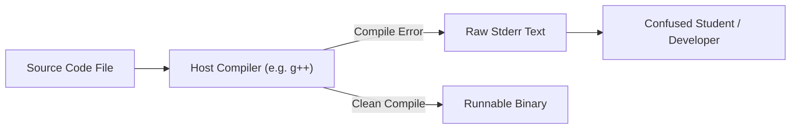
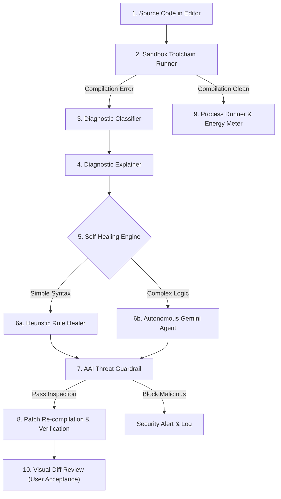

# Architecture Guide

For a simple overview, worked examples, and benchmark numbers, see [README.md](file:///w:/Projects/toacd-pbl/README.md).

---

## 1. Before Architecture: Traditional Static Compiler Workflow

In traditional compilation environments, errors produce terse diagnostic text with no explanation, automated healing, or safety checks:

### Descriptions of Before Architecture Components

- **Source Code File**: The raw C++, C, Python, or Java program edited by the user.
- **Host Compiler (e.g. `g++`)**: Standard compiler invoked directly from the terminal without wrapping.
- **Raw Stderr Text**: Cryptic, multi-line compiler error output without context or categorization.
- **Confused Student / Developer**: The user must manually decipher cryptic syntax errors and compiler warnings.
- **Runnable Binary**: Machine executable built when compilation succeeds without errors.

---

## 2. After Architecture: Green Self-Healing Compiler Workflow

The Green Self-Healing Compiler wraps host toolchains with diagnostic intelligence, dual-engine repair, security filtering, and energy telemetry:

### Descriptions of After Architecture Components

- **1. Source Code in Editor**: Web UI Code Studio where users write, load, and edit source files.
- **2. Sandbox Toolchain Runner**: Executes host compilers (`g++`, `clang++`, `gcc`, `python`, `javac`) in an isolated temporary working directory with strict timeouts.
- **3. Diagnostic Classifier**: Machine learning model (TF-IDF + Logistic Regression) that categorizes raw errors into 9 semantic categories.
- **4. Diagnostic Explainer**: Enriches errors with beginner-friendly explanations, source line context, and fix suggestions.
- **5. Self-Healing Engine**: Routes errors to either fast heuristic rules or autonomous AI repair based on user selection and error complexity.
- **6a. Heuristic Rule Healer**: Deterministic source transformations that repair simple syntax faults (missing semicolons, missing headers) in milliseconds offline.
- **6b. Autonomous Gemini Agent**: Multi-round ReAct loop powered by Google Gemini (`gemini-flash-lite-latest`) that reasons over diagnostics to repair multi-fault logic bugs.
- **7. AAI Threat Guardrail**: Four-layer security filter (normalization, signature regex, classification, AST policy) inspecting candidate patches to block prompt injection and trojans.
- **8. Patch Re-compilation & Verification**: Tests candidate patches with the compiler to confirm they compile cleanly before presenting them.
- **9. Process Runner & Energy Meter**: Runs compiled binaries, tracks CPU seconds and peak memory via `psutil`, and estimates Joules and carbon emissions.
- **10. Visual Diff Review (User Acceptance)**: Interactive UI showing side-by-side additions and deletions; patches are never applied silently without user approval.
- **Security Alert & Log**: Discards malicious patches, warns the user, and appends a tamper-evident HMAC-SHA256 record to `logs/aai_audit.jsonl`.
