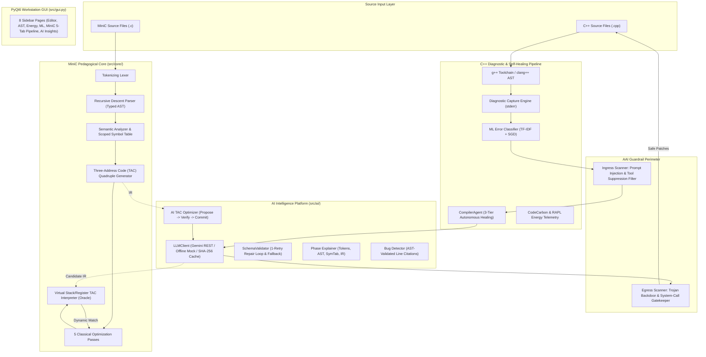

# Green Self-Healing Compiler & Agentic Optimization Platform

[](https://www.python.org/)
[](https://isocpp.org/)
[](https://gcc.gnu.org/)
[](https://ai.google.dev/)
[](https://riverbankcomputing.com/software/pyqt/)
[](file:///w:/Projects/toacd-pbl/tests)

An enterprise-grade, academic Compiler Design (PBL) platform combining classical compiler construction with modern autonomous agentic AI and dynamic differential execution verification.

---

## 1. System Overview

The platform addresses two foundational challenges in compiler design and developer tooling:

1. **Autonomous Self-Healing:** Intercepting C++ compilation errors from `g++`/`clang++`, classifying semantic root causes via machine learning, and generating verified source patches using a tiered autonomous agent (`CompilerAgent`) hardened against prompt injection and trojan injection via the `AAIGuardrail`.
2. **AI-Driven Optimization with Soundness Testing:** Applying large language models (`gemini-flash-lite-latest`) to low-level Three-Address Code (TAC) intermediate representations under the architectural principle: **"AI Proposes, Classic Compiler Verifies"**. Candidate optimizations are tested dynamically against the software TAC Interpreter Oracle before admission to ensure identical observable runtime output.

---

## 2. Architecture & Design



---

## 3. Core Packages & Components

### 3.1 C++ Self-Healing & Security Subsystem
- **`src/compiler_runner.py`**: Safe toolchain discovery and diagnostic capture engine. Sanitizes inputs against forbidden OS primitives (`system`, `popen`, `exec`, raw assembly).
- **`src/error_classifier.py`**: Multi-class machine learning classifier (TF-IDF + SGD/Logistic Regression) categorizing GCC diagnostics into 8 semantic error types.
- **`src/auto_healer.py`**: Rule-based deterministic heuristic engine performing localized regex AST corrections.
- **`src/agentic_compiler.py`**: Multi-tier autonomous healing agent coordinating localized heuristics (Tier 1), contextual LLM reasoning (Tier 2), and global architectural refactoring (Tier 3).
- **`src/aai_guardrail.py`**: Autonomous AI Guardrail intercepting ingress prompt injections and egress backdoor trojans.
- **`src/heal_loop.py`**: Energy-instrumented compilation repair loop (CodeCarbon / RAPL telemetry). PyQt6 decoupled for headless CLI and automated benchmark execution.

### 3.2 MiniC Clean-Room Compiler Core (`src/core/`)
- **`src/core/lexer.py`**: Formal tokenizing scanner converting MiniC source into typed token sequences.
- **`src/core/parser.py`**: Recursive descent parser building typed Abstract Syntax Tree (AST) nodes with visual ASCII tree formatting.
- **`src/core/semantic.py`**: Semantic type verification and hierarchical lexical scope management (`Scope`, `Symbol`, `SymbolTable`).
- **`src/core/ir.py`**: Three-Address Code (TAC) Quadruple intermediate representation generator with control-flow lowering.
- **`src/core/optimizer.py`**: 5 classical iterative optimization passes (Constant Folding, Common Subexpression Elimination, Dead Code Elimination, Copy Propagation, Algebraic Simplification).
- **`src/core/interpreter.py`**: Virtual stack/register TAC interpreter acting as the dynamic execution oracle.

### 3.3 AI Insights & Fault-Tolerant Platform (`src/ai/`)
- **`src/ai/llm_client.py`**: Provider-agnostic Gemini client (`gemini-flash-lite-latest` default) with SHA-256 prompt caching, exponential backoff, and offline mock support (`LLM_MOCK=1`).
- **`src/ai/schema_utils.py`**: Zero-Crash schema validation engine with a 1-retry self-correction feedback loop and deterministic fallback factory.
- **`src/ai/phase_explainer.py`**: Multi-phase compiler explanation synthesizer.
- **`src/ai/ai_optimizer.py`**: TAC IR optimizer implementing the "AI Proposes, Classic Compiler Verifies" gatekeeper.
- **`src/ai/bug_detector.py`**: Logic bug detector retaining only findings that cite validated AST line numbers.

---

## 4. Empirical Evaluation & Benchmark Results

The comparative evaluation was executed via `src/evaluation/benchmark.py` against live Google Gemini:

### 4.1 Comparative Self-Healing Benchmark (51 Test Fixtures)

> **Methodology Note:** Fixtures are partitioned into baseline clean files (0 initial errors) and broken files requiring repair. Repair rates are computed strictly over files needing repair.

| Metric | Rule-Based Heuristic | Autonomous Gemini Agent | Advantage (Lift) |
|:---|:---:|:---:|:---:|
| **Total Test Fixtures Evaluated** | 51 | 51 | — |
| **Baseline Clean Files (No repair needed)** | 12 / 51 (23.5%) | 12 / 51 (23.5%) | — |
| **Broken Files Requiring Repair** | 39 / 51 (76.5%) | 39 / 51 (76.5%) | — |
| **Successful Program Repairs** | **9 / 39 (23.1%)** | **31 / 39 (79.5%)** | **+56.4%** |
| **Average Repair Latency** | 1.219 s | 4.656 s | — |
| **Adversarial Ingress Interceptions** | N/A | **5 / 5 (100% Blocked by AAI Guardrail)** | Security Shield |
| **Classifier Match Accuracy** | 47.1% (24 / 51) | 47.1% (24 / 51) | Heuristic Labels |

### 4.2 Verifier Gatekeeper & Live AI Optimizer Evaluation

| Evaluation Suite | Proposals Evaluated | Admitted (Sound) | Blocked (Unsound / Crash) | Gatekeeper Soundness |
|:---|:---:|:---:|:---:|:---:|
| **Interpreter Verifier Test Suite** *(Synthetic Soundness)* | 11 | 6 (54.5%) | 5 (45.5%) | **100.0% Sound** |
| **Live Gemini TAC Optimizer** *(Live AI Proposals)* | 8 | 8 (100.0%) | 0 (0.0%) | **100.0% Sound** |

> [!NOTE]
> **Verification Model Boundary:**  
> The equivalence check performs dynamic differential testing by executing candidate IR on a test execution trace and comparing observable output. This is dynamic execution testing, not formal mathematical proof. An unsound transformation whose divergence is unexercised on the specific input trace could pass.

---

## 5. Installation & Setup

### Prerequisites
- **Operating System:** Windows 10/11, Linux (Ubuntu 20.04+), or macOS (12+)
- **Python:** 3.10, 3.11, or 3.12
- **C++ Compiler:** `g++` (MinGW-w64 on Windows, GCC on Linux, Apple Clang on macOS) supporting C++17
- **Clang Tools (Optional):** `clang++` for AST extraction

### Installation
```bash
# Clone the repository
git clone https://github.com/Ganesh-Revanth/toacd-pbl.git
cd toacd-pbl

# Create and activate virtual environment
python -m venv .venv

# Windows:
.venv\Scripts\activate
# Linux/macOS:
# source .venv/bin/activate

# Install dependencies
pip install -r requirements.txt
```

### API Key Configuration
Configure your Google AI Studio API key in a `.env` file at the repository root:
```env
GEMINI_API_KEY=AIzaSy...your_api_key_here...
```
*(Alternatively, set `export GEMINI_API_KEY="your-key"` or `$env:GEMINI_API_KEY="your-key"`).*

**Offline / Safe Demo Mode:**  
To run the platform without network access or API key:
```bash
# Set offline mock flag:
set LLM_MOCK=1          # Windows CMD
$env:LLM_MOCK="1"        # Windows PowerShell
export LLM_MOCK=1        # Linux/macOS
```

---

## 6. How to Run

### 6.1 Interactive Desktop GUI
Launch the 8-page workstation featuring the 5-tab MiniC Pipeline Inspector and asynchronous AI Insights panel:
```bash
python src/gui.py
```

### 6.2 Self-Healing Compiler CLI
Run autonomous iterative healing on any broken C++ source file:
```bash
python src/main.py test_cases/syntax_error.cpp
```

### 6.3 MiniC Clean-Room Compiler (Python API)
Inspect each classical compilation phase for a MiniC program. Run from the repository root:
```bash
# Tokenize
python -c "import sys; sys.path.insert(0,'src'); from core.lexer import Lexer; print(Lexer('int main() { return 42; }').tokenize())"

# Parse and pretty-print the AST
python -c "import sys; sys.path.insert(0,'src'); from core.lexer import Lexer; from core.parser import Parser; from core.ast_nodes import pretty_print_ast; print(pretty_print_ast(Parser(Lexer('int main() { int x = 10; return x; }').tokenize()).parse()))"

# Generate three-address code, optimize it, and run both versions
python -c "import sys; sys.path.insert(0,'src'); from core.ir import generate_ir; from core.optimizer import optimize; from core.interpreter import run_ir; ir = generate_ir('int main() { int a = 2 + 3; print(a); return a; }'); opt, stats = optimize(ir); print(len(ir), '->', len(opt), 'instructions'); print(run_ir(ir), run_ir(opt))"
```

### 6.4 Comparative Benchmark Suite
Run the full comparative evaluation across all 51 fixtures, synthetic verifier tests, and live Gemini TAC optimization:
```bash
# Run full live comparative benchmark:
python src/evaluation/benchmark.py --output results/final.csv --markdown results/benchmark_summary.md

# Run offline benchmark (without LLM):
python src/evaluation/benchmark.py --no-llm
```

### 6.5 Automated Test Suite
Execute the comprehensive 161-test pytest validation suite:
```bash
pytest tests/ -v
```

### 6.6 Web Studio (browser interface)
A browser interface that reuses the same Python modules and needs no extra packages:
```bash
python src/web/server.py              # opens http://127.0.0.1:8765
python src/web/server.py --no-browser --port 9000
```
Pages: C++ workspace (check, explanations, suggested fixes), Changes (every proposed fix with accept / reject / undo), MiniC pipeline, Syntax tree (MiniC and clang), AI insights, Benchmark and Architecture.

- Fixes are only *proposed*. The browser shows a diff and nothing changes until you press Accept.
- The server listens on `127.0.0.1` only and never runs compiled C++ programs.
- AI features need `GEMINI_API_KEY` in the environment (or a `.env` file). Without it, everything else still works. `LLM_MOCK=1` gives canned answers for an offline demo, and the UI shows a banner while it is on.
- The Benchmark page recomputes every figure from `results/final.csv` when it loads.

---

## 7. Project Structure & Documentation

```
toacd-pbl/
├── src/
│   ├── core/                  # MiniC Compiler (Lexer, Parser, Semantic, IR, Optimizer, Interpreter)
│   ├── ai/                    # AI Subsystem (LLMClient, Explainer, TAC Optimizer, Bug Detector)
│   ├── evaluation/            # Benchmark Harness (benchmark.py)
│   ├── compiler_runner.py     # g++/clang++ toolchain runner & sanitizer
│   ├── error_parser.py        # Diagnostic stderr parser & context builder
│   ├── error_classifier.py    # TF-IDF + SGD ML error category classifier
│   ├── auto_healer.py         # Static rule-based heuristic healing engine
│   ├── agentic_compiler.py    # Autonomous 3-tier self-healing compiler agent
│   ├── aai_guardrail.py       # Autonomous AI Ingress & Egress security guardrail
│   ├── heal_loop.py           # Energy-telemetry healing iteration loop (CodeCarbon)
│   └── gui.py                 # 8-page PyQt6 desktop workstation
├── tests/                     # 9 automated pytest test suites (161 passing tests)
├── test_cases/                # 51 C++ test cases (syntax, semantic, security, attacks)
├── results/                   # Benchmark evaluation artifacts (final.csv, summary.md)
├── DOCUMENTATION.md           # Comprehensive technical specification & architecture guide
├── ARCHITECTURE_GUIDE.md      # Detailed subsystem architecture & pedagogical breakdown
├── project_explanation.md     # Viva voce & academic presentation walkthrough
├── PBL_Report.md              # Academic Project-Based Learning report
└── requirements.txt           # Python dependencies
```

---

## 8. Academic Integrity & Ethics

This project was developed for academic Project-Based Learning in Compiler Design. All empirical figures reported in this documentation reflect verified runs against real GCC diagnostics, software TAC interpreter executions, and live Google Gemini API endpoints. The guardrail architecture explicitly treats LLMs as untrusted proposition generators requiring dynamic execution verification before code admission.

