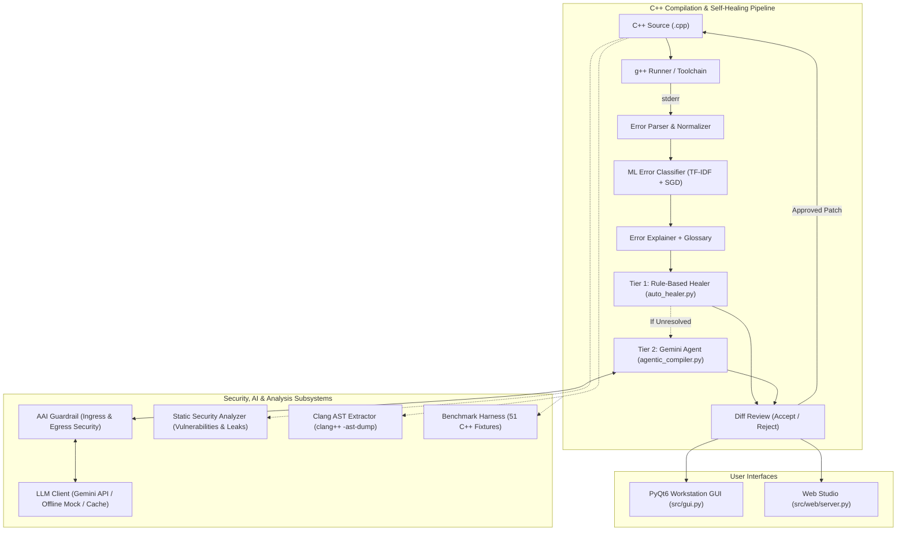

# Green Self-Healing Compiler & Agentic Optimization Platform

[](https://www.python.org/)
[](https://isocpp.org/)
[](https://gcc.gnu.org/)
[](https://ai.google.dev/)
[](https://riverbankcomputing.com/software/pyqt/)
[](file:///w:/Projects/toacd-pbl/tests)

An enterprise-grade, academic Compiler Design (PBL) platform combining standard C++ compiler toolchains (`g++`, `clang++`) with multi-tier autonomous self-healing, machine-learning diagnostic classification, strict AI security guardrails, energy telemetry, interactive PyQt6 workstation, and a modern Web Studio.

---

## 1. System Overview

The platform addresses core challenges in modern compiler engineering, developer tooling, and automated program repair (APR):

1. **Intelligent Compiler Wrapping & Diagnostic Capture:** Intercepts raw `stderr` streams from `g++`/`clang++`, normalizes diagnostic messages into structured records, and classifies semantic error categories using machine learning.
2. **Two-Tier Autonomous Self-Healing:**
   - **Tier 1 (Deterministic Rule-Based Healer):** High-speed regex and AST-guided fixes for common syntax errors (missing semicolons, misplaced braces, typo keywords, header mappings).
   - **Tier 2 (Autonomous ReAct Gemini Agent):** Multi-step contextual repair powered by Google Gemini (`gemini-flash-lite-latest`), analyzing compiler diagnostics and validating candidate fixes iteratively with `g++`.
3. **Interactive Diff Review:** No changes are applied silently; proposed patches are presented as reviewable visual diffs requiring explicit user acceptance or rejection.
4. **Security Hardening & Guardrails:** Hardened against prompt injection (ingress) and trojan/backdoor payload insertion (egress) via `AAIGuardrail`, supplemented by static AST-less security analysis.
5. **Unified Workstations:** Provides both an 6-page PyQt6 desktop GUI and a local browser-based Web Studio for editing, compiling, AST inspection, diff reviews, and live benchmark evidence.

---

## 2. Architecture & Design

The platform operates as an intelligent meta-layer over `g++`/`clang++`:



---

## 3. Core Packages & Components

### 3.1 C++ Self-Healing & Security Subsystem
- **`src/compiler_runner.py`**: Safe toolchain discovery and diagnostic capture engine. Discovers `g++` on PATH or MinGW/MSYS2 locations and sanitizes inputs against forbidden OS primitives (`system`, `popen`, `exec`, raw assembly).
- **`src/error_parser.py`**: Decomposes raw compiler diagnostics into structured `CompilerError` records with line/column pointers and visual source context.
- **`src/error_normalizer.py`**: Abstract token normalizer creating dataset representations for ML and readable formats for UI.
- **`src/error_classifier.py`**: Multi-class machine learning classifier (TF-IDF + SGD/Logistic Regression) categorizing diagnostics into 8 semantic error types.
- **`src/error_explainer.py`**: Multi-tier diagnostic enrichment engine combining curated glossary templates, ML category explanations, and regex fallbacks.
- **`src/auto_healer.py`**: Deterministic heuristic engine performing localized regex AST corrections (missing semicolons, brace balancing, keyword typos, header injection).
- **`src/agentic_compiler.py`**: Autonomous ReAct healing agent coordinating multi-step repair attempts with live `g++` compilation feedback.
- **`src/aai_guardrail.py`**: Autonomous AI Guardrail intercepting ingress prompt injections and egress backdoor trojans.
- **`src/security_analyzer.py`**: Static AST-less security analyzer scanning for unsafe APIs (`gets`, `strcpy`, `system`) and memory tracking (`malloc`/`free` scope depth).
- **`src/heal_loop.py`**: Energy-instrumented compilation repair loop with CodeCarbon/RAPL telemetry.

### 3.2 AI & Infrastructure (`src/ai/`)
- **`src/ai/llm_client.py`**: Provider-agnostic Gemini client (`gemini-flash-lite-latest` default) with SHA-256 prompt caching, exponential backoff retries, threat guardrail routing, and offline mock support (`LLM_MOCK=1`).
- **`src/ai/__init__.py`**: Exports `LLMClient` for clean integration across agentic and web backends.

---

## 4. Empirical Evaluation & Benchmark Results

The multi-language comparative evaluation was executed via src/evaluation/benchmark.py across 40 test fixtures in 	est_cases/<lang>/ (C++, C, Python, Java).

### 4.1 Multi-Language Architecture & Pipeline Capabilities

| Language | Target Toolchain | Error Categorization Method | Self-Healing Pipeline |
|:---|:---|:---|:---|
| **C++** | g++ | **Machine Learning** (Scikit-Learn SGDClassifier / TF-IDF, 67k GCC rows) | **Two-Tier**: Rule-Based Heuristic (uto_healer.py) + Autonomous Gemini Agent |
| **C** | gcc -std=c11 | **Machine Learning** (Scikit-Learn SGDClassifier / TF-IDF, 67k GCC rows) | **Two-Tier**: Rule-Based Heuristic (uto_healer.py) + Autonomous Gemini Agent |
| **Python** | python -m py_compile | **Deterministic Keywords** (AST / SyntaxError mapping, no ML) | **Autonomous Gemini Agent Only** (with fast heuristic tool assistance) |
| **Java** | javac | **Deterministic Keywords** (Compiler diagnostic mapping, no ML) | **Autonomous Gemini Agent Only** (with fast heuristic tool assistance) |

### 4.2 Per-Language Benchmark Verification Summary

> **Methodology Note:** Fixtures are partitioned into baseline clean files (0 initial errors) and broken files requiring repair. Repair rates are computed strictly over files needing repair.

| Language | Total | Baseline Clean | Broken (Need Repair) | Category Match | Rule-Based Repair Rate | Rule Latency | Autonomous Gemini Agent | Gemini Latency |
|:---|:---:|:---:|:---:|:---:|:---:|:---:|:---:|:---:|
| **C++** | 10 | 2 | 8 | 60.0% (6/10) | **50.0%** (4/8) | 2.001 s | **87.5%** (7/8) | 35.856 s |
| **C** | 10 | 2 | 8 | 60.0% (6/10) | **100.0%** (8/8) | 0.798 s | **100.0%** (8/8) | 10.080 s |
| **Python** | 10 | 2 | 8 | 100.0% (10/10) | — *(N/A: Gemini only)* | — | **100.0%** (8/8) | 0.319 s |
| **Java** | 10 | 2 | 8 | 100.0% (10/10) | — *(N/A: Gemini only)* | — | **100.0%** (8/8) | 1.055 s |

### 4.3 Overall Multi-Language Aggregate Metrics

| Metric | Rule-Based Heuristic | Autonomous Gemini Agent | Advantage (Lift) |
|:---|:---:|:---:|:---:|
| **Total Fixtures Evaluated** | 40 | 40 | — |
| **Baseline Clean Files (No repair needed)** | 8 / 40 (20.0%) | 8 / 40 (20.0%) | — |
| **Broken Files Requiring Repair** | 32 / 40 (80.0%) | 32 / 40 (80.0%) | — |
| **Rule-Active Fixtures (C++ / C)** | 16 | 16 | — |
| **Successful Program Repairs** | **12 / 16 (75.0%)** | **31 / 32 (96.9%)** | **+21.9%** |
| **Average Repair Latency** | **1.400 s** | **11.828 s** | — |
| **Diagnostic Category Match Accuracy** | **80.0% (32 / 40)** | **80.0% (32 / 40)** | ML (C/C++) + Keywords (Py/Java) |

*All figures are recomputed directly from 
esults/final.csv and documented in 
esults/benchmark_summary.md.*

---


## 5. Installation & Setup

### Prerequisites
- **Operating System:** Windows 10/11, Linux (Ubuntu 20.04+), or macOS (12+)
- **Python:** 3.10, 3.11, or 3.12
- **C++ Compiler:** `g++` (MinGW-w64 on Windows, GCC on Linux, Apple Clang on macOS) supporting C++17
- **Clang Tools (Optional):** `clang++` for AST extraction

### Installation
```bash
# Clone the repository
git clone https://github.com/Ganesh-Revanth/toacd-pbl.git
cd toacd-pbl

# Create and activate virtual environment
python -m venv .venv

# Windows:
.venv\Scripts\activate
# Linux/macOS:
# source .venv/bin/activate

# Install dependencies
pip install -r requirements.txt
```

### API Key Configuration
Configure your Google AI Studio API key in a `.env` file at the repository root:
```env
GEMINI_API_KEY=AIzaSy...your_api_key_here...
```
*(Alternatively, set `export GEMINI_API_KEY="your-key"` or `$env:GEMINI_API_KEY="your-key"`).*

**Offline / Safe Demo Mode:**  
To run the platform without network access or API key:
```bash
# Set offline mock flag:
set LLM_MOCK=1          # Windows CMD
$env:LLM_MOCK="1"        # Windows PowerShell
export LLM_MOCK=1        # Linux/macOS
```

---

## 6. How to Run

### 6.1 Interactive Desktop GUI
Launch the PyQt6 workstation with 6 dedicated sidebar modules (Editor, AST Explorer, Energy Dashboard, Call Graph, ML Inspector, Healing Dashboard):
```bash
python src/gui.py
```

### 6.2 Self-Healing Compiler CLI
Run autonomous iterative healing on any broken C++ source file:
```bash
python src/main.py test_cases/syntax_error.cpp
```

### 6.3 Comparative Benchmark Suite
Run the full comparative evaluation across all 40 multi-language fixtures in test_cases/<lang>/ (C++, C, Python, Java):
```bash
# Run full live comparative benchmark:
python src/evaluation/benchmark.py --output results/final.csv --markdown results/benchmark_summary.md

# Run offline benchmark (without LLM):
python src/evaluation/benchmark.py --no-llm
```

### 6.4 Automated Test Suite
Execute the comprehensive pytest validation suite (70 passing tests):
```bash
pytest tests/ -q
```

### 6.5 Web Studio (Browser Interface)
A lightweight browser interface that reuses the existing Python modules with zero extra dependencies:
```bash
python src/web/server.py              # opens http://127.0.0.1:8765
python src/web/server.py --no-browser --port 9000
```
- **C++ Studio:** Includes full code editor, **Open / Save file**, **Compile** (invoking `g++`), **Compile & Run** (with stdin/stdout/stderr console), **Diagnostics**, and **Review**.
- **Syntax Tree:** Dedicated sidebar page featuring an interactive node-and-edge SVG AST diagram (pan, zoom, fit, subtree collapse, node search, line-tracking with linked source viewer, and SVG export).
- **Changes Page:** Review history of proposed patches with one-click Accept, Reject, or Undo.
- **Benchmark & Architecture:** Live empirical figures loaded directly from `results/final.csv` and interactive hand-drawn SVG architecture diagrams.
- **Safety Controls:**
  - Fixes are only *proposed*; the browser shows unified diffs and nothing is written to disk without explicit approval.
  - **Run** compiles C++ and executes it locally with a 5-second timeout, 64 KB output cap, isolated temp directory, and OS limits. Code blocked by security checks is never executed.
  - Server binds strictly to `127.0.0.1` by default; execution is automatically disabled if bound to external hosts.

---

## 7. Project Structure

```
toacd-pbl/
├── src/
│   ├── ai/                    # AI Subsystem (LLMClient with cache & guardrail routing)
│   ├── evaluation/            # Benchmark Harness (benchmark.py)
│   ├── web/                   # Web Studio backend (server.py) and frontend (static/)
│   ├── compiler_runner.py     # g++/clang++ toolchain runner & sanitizer
│   ├── error_parser.py        # Diagnostic stderr parser & context builder
│   ├── error_classifier.py    # TF-IDF + SGD ML error category classifier
│   ├── error_explainer.py     # Multi-tier explanation engine (glossary + ML)
│   ├── auto_healer.py         # Static rule-based heuristic healing engine
│   ├── agentic_compiler.py    # Autonomous multi-tier self-healing compiler agent
│   ├── aai_guardrail.py       # Autonomous AI Ingress & Egress security guardrail
│   ├── security_analyzer.py   # Static AST-less security scanner
│   ├── ast_extractor.py       # Clang AST extraction wrapper
│   ├── heal_loop.py           # Energy-telemetry healing iteration loop (CodeCarbon)
│   └── gui.py                 # 6-page PyQt6 desktop workstation
├── tests/                     # Automated pytest test suites (70 passing tests)
├── test_cases/                # 40 multi-language test cases in test_cases/<lang>/ (C++, C, Python, Java) plus attacks suite (syntax, semantic, security, attacks)
├── results/                   # Benchmark evaluation artifacts (final.csv, summary.md)
├── scripts/                   # Faculty defense live verification script
├── DOCUMENTATION.md           # Comprehensive technical specification & architecture guide
├── ARCHITECTURE_GUIDE.md      # Detailed subsystem architecture & pedagogical breakdown
├── PBL_Report.md              # Academic Project-Based Learning report
└── requirements.txt           # Python dependencies
```

---

## 8. Academic Integrity & Ethics

This project was developed for academic Project-Based Learning in Compiler Design. All empirical figures reported in this documentation reflect verified runs against real GCC diagnostics and live Google Gemini API endpoints. The guardrail architecture explicitly treats LLMs as untrusted proposition generators requiring strict security inspection and compiler verification before code admission.
